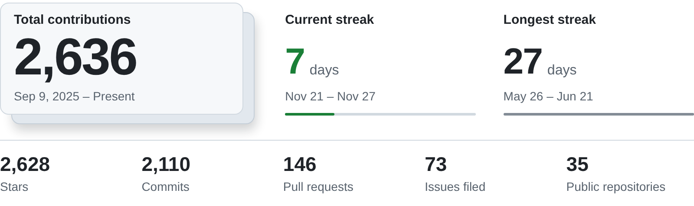

## Ling

### GitHub activity

<!-- activity:start -->
<picture>
  <source media="(max-width: 767px) and (prefers-color-scheme: dark)" srcset="./assets/activity/stacked-compact-dark.png" width="360" />
  <source media="(max-width: 767px) and (prefers-color-scheme: light)" srcset="./assets/activity/stacked-compact-light.png" width="360" />
  <source media="(prefers-color-scheme: dark)" srcset="./assets/activity/stacked-wide-dark.png" />
  
</picture>
<!-- activity:end -->

[belloshehubz@gmail.com](mailto:belloshehubz@gmail.com)

Sponsored by Sentry.
